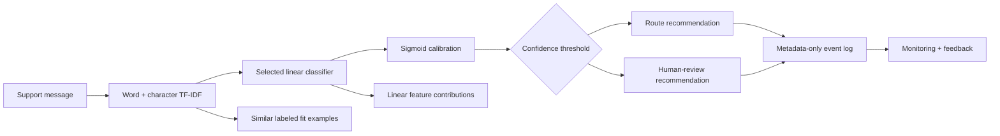

# SignalDesk

[](https://github.com/maayav/signaldesk/actions/workflows/ci.yml)
[](https://www.python.org/downloads/)
[](LICENSE)

**Support-ticket triage with calibrated ML, selective routing, and operational monitoring.**

SignalDesk classifies a support message into one of 77 banking intents, shows confidence and similar labeled examples, and recommends **route** or **human review**. It includes the reproducible training pipeline, held-out evaluation, FastAPI service, Streamlit dashboard, SQLite event store, and Docker setup.

Runs locally on a CPU. No paid APIs, API keys, or GPU required.

[Quickstart](#quickstart) · [Results](#benchmark-results) · [Architecture](docs/architecture.md) · [Model card](docs/model-card.md) · [Demo guide](docs/demo-script.md)

## What you can do

- **Inspect a ticket:** compare the top three intents, confidence, positive linear feature contributions, and cosine-similar training examples.
- **Run a batch:** upload a CSV, filter messages needing review, and download the results. A sample is in [examples/tickets.csv](examples/tickets.csv).
- **Understand the experiment:** compare two classifiers and inspect calibration, per-intent metrics, and common confusions.
- **Monitor predictions:** track intent mix, review rate, and confidence-distribution drift; attach corrected-intent feedback without storing submitted ticket text.
- **Reproduce the system:** verify source data hashes, rebuild model artifacts, run tests, and start both services with Docker Compose.

## Quickstart

Use Python 3.12. These commands use a POSIX shell and the repository’s pinned dependency set.

```bash
git clone https://github.com/maayav/signaldesk.git
cd signaldesk
python3.12 -m venv .venv
source .venv/bin/activate
PIP_USER=0 python -m pip install -r requirements-lock.txt
PIP_USER=0 python -m pip install --no-deps -e .
bash scripts/serve.sh
```

Open [the dashboard](http://localhost:8501) and [interactive API documentation](http://localhost:8000/docs). Ctrl+C stops both services. Trained artifacts are included, so training is optional for the first run.

Try **“The ATM kept my card and I need it back.”** Inspect the alternatives and supporting examples, then try an ambiguous or unrelated message to explore the review policy’s limits. Follow [the five-minute demo](docs/demo-script.md) for a complete walkthrough.

To run the services separately, use `make api` and `make ui` in separate terminals from the repository root. `make install` prepares the pinned environment from scratch. If artifacts are missing, reproduce them using the commands below and restart the API.

### Docker

With Docker Engine and Docker Compose installed:

```bash
docker compose up --build
```

Open [port 8501](http://localhost:8501) for the dashboard. The API is on [port 8000](http://localhost:8000/docs). Host ports bind to the loopback interface; this starts a local deployment. Stop it with `docker compose down`.

If those ports are busy:

```bash
SIGNALDESK_API_PORT=18000 SIGNALDESK_UI_PORT=18501 docker compose up --build
```

## Benchmark results

The included run selected **one-versus-rest logistic regression**, model version `banking77-c9813bba904c`. Results on **BANKING77’s 3,080 official test queries**:

| Metric | Result |
| --- | ---: |
| Overall accuracy | 88.80% |
| Macro F1 | 0.8877 |
| Top-3 accuracy | 96.56% |
| Routing coverage | 83.93% — 2,585 queries |
| Accuracy among routed queries | 95.20% |
| Queries sent for review | 495 |
| Multiclass log loss | 0.5436 |
| Top-label calibration error, 10 bins | 0.1700 |

The independent selection partition gave logistic regression macro F1 **0.8730**, versus **0.8703** for the linear SVM. The routing threshold, **0.5127**, was chosen on a separate policy-validation partition before evaluating the official test set.

Report **routing coverage and routed-query accuracy together**. The policy targets 95% empirical accuracy on accepted validation queries; it is not a future-data guarantee. The reliability table shows remaining underconfidence, and this run does not establish improvement over uncalibrated probabilities. See the [model card](docs/model-card.md) and exact [metrics](artifacts/metrics.json).

## How it works



The pipeline checks pinned [BANKING77 source files](data/README.md) against SHA-256 hashes and audits normalized exact-text duplicates. Cleaned official-training rows are stratified into **55% fit / 15% calibration / 15% selection / 15% policy validation**. Vocabulary, classifier weights, and retrieval examples are fit-only. Official test labels are used for final evaluation, with no subsequent refit or threshold adjustment.

Similar-example retrieval uses **word TF-IDF cosine similarity**. Feature contributions explain the underlying linear class score, rather than the calibrated probability. Confidence drift compares recent prediction-confidence histograms with policy-validation traffic; it does not measure accuracy loss.

## Reproduce and verify

From the activated environment:

```bash
python -m signaldesk.data --data-dir data/raw
OMP_NUM_THREADS=1 OPENBLAS_NUM_THREADS=1 python -m signaldesk.train \
  --data-dir data/raw --artifact-dir artifacts
python -m pytest -q
python -m ruff check src app tests scripts
```

Training writes the model, exact metrics, partition identities, and a checksum manifest to `artifacts/`. The [evaluation notebook](notebooks/01_data_and_evaluation.ipynb) walks through data balance, splits, calibration, and error analysis; select the repository’s virtual environment in your notebook editor.

The 24 November 2026 prepublication run passed **63 tests**, lint, dependency checks, notebook execution, the final Docker stack contracts, and browser checks across all four dashboard pages. See the [verification record](docs/verification.md) for exact evidence. The CI badge above reflects the actual GitHub Actions workflow status; the workflow also rebuilds artifacts from verified source data and checks the Docker stack.

## API

```bash
curl http://localhost:8000/readyz

curl -X POST http://localhost:8000/predict \
  -H 'Content-Type: application/json' \
  -d '{"text":"The ATM kept my card and I need it back."}'
```

| Endpoint | Purpose |
| --- | --- |
| `GET /health`, `GET /readyz` | Service status and model readiness. |
| `GET /model`, `GET /metrics` | Model metadata, labels, policy, and evaluation results. |
| `POST /predict` | Classify one message. |
| `POST /predict/batch` | Classify 1–100 messages. |
| `GET /monitoring` | Recent operational statistics. |
| `POST /feedback` | Attach a corrected intent to a prediction ID. |

Messages must contain 3–4,000 characters after trimming. Feedback does not automatically retrain the serving model. Exact request/response schemas are available in the running [OpenAPI documentation](http://localhost:8000/docs).

## Documentation

| Guide | Contents |
| --- | --- |
| [Architecture and operation](docs/architecture.md) | Components, environment variables, persistence, and deployment. |
| [Model card](docs/model-card.md) | Data provenance, leakage controls, training, results, and limits. |
| [Verification record](docs/verification.md) | Dated checks and measured evidence. |
| [Demo script](docs/demo-script.md) | A five-minute product and engineering walkthrough. |
| [Interview guide](docs/interview-guide.md) | Design choices and questions to prepare. |
| [Resume wording](docs/resume.md) | Measured project bullets and defensible claims. |
| [Learning roadmap](docs/learning-roadmap.md) | Ablations, domain-mismatch evaluation, and model extensions. |
| [Contributing](CONTRIBUTING.md) | Setup, checks, and contribution scope. |

## Scope and attribution

This is a local ML engineering demonstration for a fixed English banking-intent taxonomy. It recommends routing; it does not dispatch messages to real support teams, access accounts, or resolve tickets. Confidence-based review is not a complete out-of-domain detector. Authentication and managed hosting are outside the current implementation; see [security guidance](SECURITY.md) before adapting the service.

Original code is [MIT licensed](LICENSE). BANKING77 is provided by PolyAI under [CC BY 4.0](https://github.com/PolyAI-LDN/task-specific-datasets/blob/57ec275d8078af65b7731c2a98be812d844a6d6b/LICENSE). Dataset citation, source transformations, dependency licenses, and project inspiration are recorded in [Attribution](docs/ATTRIBUTION.md).
