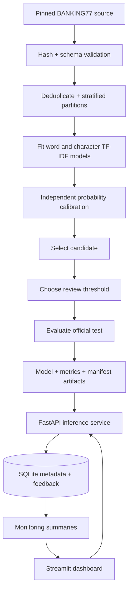

# Architecture and operation

## Components



The dashboard talks to the API over HTTP; it does not load model artifacts directly. The API loads one trusted model bundle and uses the same prediction function for single and batch requests. A client request cannot choose an arbitrary model file.

Training and serving are separate processes. Training writes versioned metadata and reproducible results. Serving starts from those artifacts and does not train on incoming traffic. The retrieval index contains labeled fit examples, while the event database stores request metadata without raw submitted message text.

## Run configuration

| Environment variable | Default | Purpose |
| --- | --- | --- |
| `SIGNALDESK_ARTIFACT_DIR` | `artifacts` | Directory containing the trusted model bundle and reports. |
| `SIGNALDESK_DB_PATH` | `var/events.sqlite3` | SQLite prediction/feedback store. |
| `SIGNALDESK_API_URL` | `http://127.0.0.1:8000` | API base URL used by the Streamlit process. |

Run shell commands from the project root so relative paths resolve consistently. Python 3.12 is the validated runtime; the package declares supported Python versions in `pyproject.toml`. Direct dependencies are pinned there. `requirements-lock.txt` records the complete tested environment.

## Startup and health

Start the API with:

```bash
uvicorn signaldesk.api:app --host 127.0.0.1 --port 8000
```

`GET /health` reports service/model status. `GET /readyz` reports whether a usable model is loaded. If artifacts are missing, run the dataset and training commands, then restart the process. Avoid leaving a running API pointed at files being replaced by a concurrent training job; deploy an immutable artifact set and restart the process to release a new model.

Start the dashboard with:

```bash
streamlit run app/dashboard.py
```

For Docker:

```bash
docker compose up --build
```

Compose runs the API and dashboard as separate services. The dashboard addresses the API by its Compose service name. Host ports are bound to the loopback interface for local access. A named or mounted SQLite data directory preserves local operational events according to the Compose configuration. Stop the services with `docker compose down`.

Both services declare HTTP health probes. Use `docker compose up -d --build --wait` when another process must call the stack immediately after startup; this waits for the API and dashboard to accept requests.

To use different host ports, run `SIGNALDESK_API_PORT=18000 SIGNALDESK_UI_PORT=18501 docker compose up --build`. The services still communicate on their internal default ports.

The Docker setup is a local deployment. The repository does not contain a live hosted URL, paid cloud infrastructure, or external account configuration.

## Prediction contract

`POST /predict` accepts `{"text": "..."}`. `POST /predict/batch` accepts `{"texts": ["...", "..."]}` with at most 100 messages. Validation rejects blank or oversized inputs before inference.

Each prediction includes a prediction ID, model version, predicted intent, maximum calibrated probability, route/review decision, top intent candidates, similar fit examples, local feature contributions, and measured inference latency. Batch latency is the batch inference duration divided by the number of messages, rather than a separate timing for each message. The API response and interactive OpenAPI page are the source of truth for exact field types and limits.

The review decision is based on the configured threshold. It is not an emergency classifier, escalation severity score, or customer-service policy engine. Intent labels name model categories; integrating them with real support teams requires a separate mapping.

## Persistence and monitoring

SQLite provides local durable event and feedback storage. It is appropriate for this single-service demonstration. The stored event metadata supports counts, confidence histograms, intent distribution, and recent predictions. Corrected-intent feedback attaches to a prediction ID.

Jensen–Shannon divergence compares normalized confidence histograms against the policy-validation reference. The current window is the latest 1,000 predictions for the loaded model version. Fewer than 100 predictions yield `insufficient_data`; divergence at least 0.10 yields `shift_detected`. These are explicit heuristic settings in the monitoring module, not statistically calibrated alert thresholds. Monitoring status describes distribution change; labeled outcomes are needed to measure actual performance.

No raw ticket body is persisted in the event store. Requests still pass through the dashboard/API process memory, and deployment platform logs must be configured separately. The repository does not claim a full enterprise privacy or compliance program.

## Release checklist

1. Recreate the environment from pinned dependencies.
2. Verify the dataset hashes, run training, and retain the resulting model, metrics, and manifest as one release.
3. Run the tests and inspect the evaluation report and common confusions.
4. Start the API, verify `/readyz`, and run the demo against that exact artifact.
5. Release the immutable artifact set and restart serving; compare monitoring statistics after rollout.

For multi-instance hosting, replace local SQLite with a shared database, add authentication/rate limits and an HTTPS reverse proxy, and keep artifact releases separate from application request handlers. Those are future deployment extensions, not features already delivered here.
